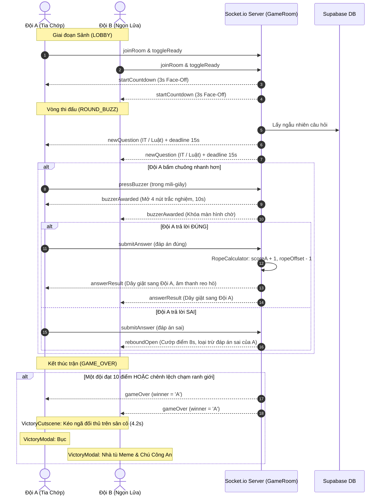

# 🏛️ TỔNG QUAN DỰ ÁN & KIẾN TRÚC HỆ THỐNG

## 1. Giới Thiệu Dự Án
- **Tên dự án:** KÉO CO TRI THỨC (Trạm 1: Thử Thách Tri Tuệ)
- **Mục đích:** Web App trò chơi đối kháng kéo co đối kháng kiến thức thời gian thực phục vụ ngày hội sinh viên, sự kiện tuyển sinh và hoạt động ngoại khóa tại Trường Đại học Văn Hiến (VHU).
- **Bộ câu hỏi:** 600 câu hỏi trắc nghiệm thuộc 2 lĩnh vực:
  - **Công nghệ thông tin (IT):** An toàn thông tin, mạng máy tính, hệ điều hành, phần cứng.
  - **Pháp luật đời sống (Law):** Luật an ninh mạng, quyền sở hữu trí tuệ, luật dân sự sinh viên.

---

## 2. Công Nghệ Sử Dụng (Tech Stack)

### Frontend (`src/frontend`)
- **Framework:** React 18 + Vite (SPA)
- **Styling:** Vanilla CSS (Design system Neo-Brutalism Comic 2D trong `src/styles/index.css`)
- **Hiệu ứng & Hoạt họa:** Canvas-confetti, SVG Chibi nhân vật vẽ tay, CSS Keyframes animation
- **Âm thanh & Phản hồi:** Web Audio API Synthesizer (tự tạo âm không phụ thuộc file mp3 ngoài) & Vibration Haptic API cho điện thoại di động
- **Deploy:** Vercel (Auto-deploy qua branch `main`)

### Backend (`src/backend`)
- **Runtime:** Node.js (v18+) + Express
- **Giao tiếp thời gian thực:** Socket.io (WebSocket với fallback Polling)
- **Cơ sở dữ liệu:** Supabase PostgreSQL qua Connection Pooler
- **Deploy:** Render / Railway (Web Service chạy liên tục hỗ trợ kết nối WebSocket)

---

## 3. Kiến Trúc Luồng Trận Đấu (Game Lifecycle)

